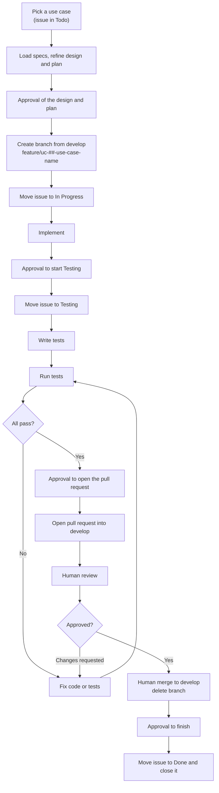

# Development Workflow Document — Hermes API

## 1. Purpose

This document defines **how a use case moves from backlog to merged** — the branch, the issue status
transitions, the testing gate, and the pull request. It is the standard every contributor (human or
agent) follows so that each use case in the
[Use Case Specification Document](Use%20Case%20Specification%20Document.md) is delivered the same way.

It complements the [Testing Specification Document](Testing%20Specification%20Document.md), which
defines *how* the tests themselves are written; this document defines *when* they happen in the
delivery flow. It is the normative form of the approved
[Workflow](../initial/Workflow.md), which wins if the two ever differ.

> **One use case = one branch = one issue = one pull request.**

The repository lives on Forgejo at `git.techcraftsmen.net`, with a read-only mirror on GitHub. Issues
and pull requests are on Forgejo.

## 2. Workflow at a glance



## 3. Issue status lifecycle

| Order | Status | Set when |
| --- | --- | --- |
| 1 | **Todo** | The use case has not been started (default). |
| 2 | **In Progress** | A branch has been created and implementation has begun. This is the only status change made without asking. |
| 3 | **Testing** | Implementation is finished; tests are being written, run, and fixed until green. |
| 4 | **Done** | The pull request has been reviewed and merged; the issue is then **closed**. |

An issue only ever moves **forward** during normal flow. If review requests changes, work continues
on the same branch (still linked to the same issue) until tests pass again and the pull request is
re-reviewed.

## 4. Step-by-step

### Step 1 — Load the specifications and refine the plan

Read the use case and its traced requirements, turn them into a concrete design and a written,
test-first plan, and **wait for approval before writing any code**.

### Step 2 — Branch from `develop`

Every use case is implemented on its own branch, created from an up-to-date `develop`:

```bash
git switch develop
git pull
git switch -c feature/uc-01-send-email
```

**Branch naming pattern:**

```
feature/uc-##-use-case-name
```

| Use case | Branch |
| --- | --- |
| UC-01: Send an email | `feature/uc-01-send-email` |
| UC-02: Configure a client and its keys | `feature/uc-02-configure-a-client-and-its-keys` |
| UC-03: Alert the owner at the daily limit | `feature/uc-03-alert-the-owner-at-the-daily-limit` |
| UC-04: Send a contact message | `feature/uc-04-send-a-contact-message` |
| UC-05: Deliver Heimdall's email through Hermes | `feature/uc-05-deliver-heimdalls-email-through-hermes` |
| UC-06: Check health | `feature/uc-06-check-health` |

### Step 3 — Move the issue to **In Progress**

As soon as the branch exists and work starts, set the issue `Status` to **In Progress**.

### Step 4 — Implement

Implement per the specification (main flow and alternative flows) and the project's architecture and
technology stack. All commits go on the branch. When the implementation is code-complete, **stop and
ask** before advancing.

### Step 5 — Move the issue to **Testing**

After approval, set the issue `Status` to **Testing**. This signals that the work is code-complete and
the testing gate is now in progress.

### Step 6 — Test until green

Following the [Testing Specification Document](Testing%20Specification%20Document.md):

1. Write the tests for the main flow and each applicable `AF-xx` alternative flow.
2. **Run the tests** (`dotnet test`).
3. **Fix** any failures — in the implementation or the tests.
4. **Re-run**, and repeat until every test passes.

A use case does not leave the Testing stage until the full suite is green. Report the results and
**stop and ask** before opening a pull request.

### Step 7 — Open a pull request

After approval, push the branch and open a pull request from `feature/uc-##-…` into `develop`. The
description references the use case and its issue, so the merge closes it.

### Step 8 — Human review and merge

- The pull request is **reviewed by a human**. Requested changes are addressed on the same branch
  (back to Step 6 whenever code changes, so the suite stays green).
- Once approved, a human **merges the pull request**.
- The **branch is deleted** after the merge.

> Review and merge are **human actions**. An agent may prepare and push the pull request, but must not
> self-approve or merge it, and must not delete the branch.

### Step 9 — Close the issue

After the merge, **ask** before finishing, then set the issue `Status` to **Done** and **close** it.

## 5. Work outside this repository

The first version also changes `dotnet-messaging`, `personal-page`, `heimdall-api` and `yggdrasil`.
Those changes follow each repository's own branching model and checks. The issue tracking the work
stays in this repository, and the pull request in the other repository refers to it. The approval
gates above still apply.

## 6. Definition of Done

A use case is done only when **all** of the following hold:

- [ ] Implemented on a `feature/uc-##-use-case-name` branch created from `develop`.
- [ ] Main flow and every alternative flow from the specification are implemented.
- [ ] Tests cover it per the Testing Specification.
- [ ] The full test suite passes, both `Category=Unit` and `Category=Functional`.
- [ ] A pull request was reviewed by a human and merged.
- [ ] The branch was deleted.
- [ ] The issue is in **Done** and closed.

## 7. References

- [Use Case Specification Document](Use%20Case%20Specification%20Document.md) — the use case definitions and their flows.
- [Testing Specification Document](Testing%20Specification%20Document.md) — how the tests are written.
- [System Requirements Document](System%20Requirements%20Document.md) — functional and non-functional requirements.
- [Technology Stack Document](Technology%20Stack%20Document.md) — technologies and versions used.
