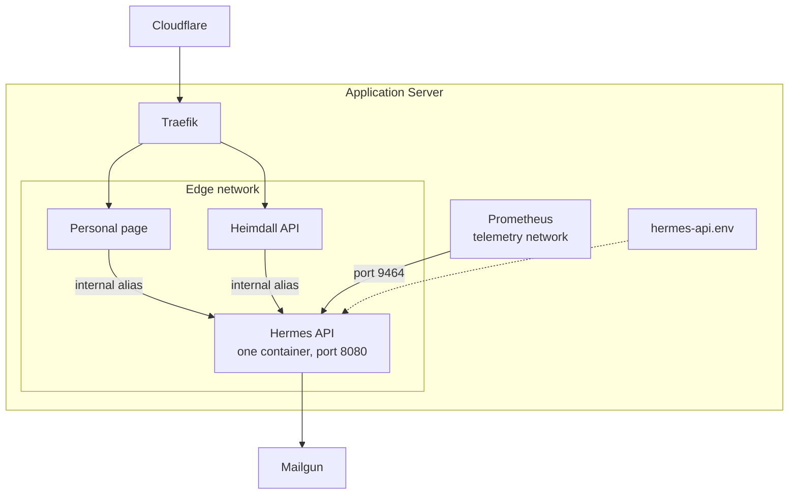

# Operations & Infrastructure Document — Hermes API

## 1. Introduction

### 1.1 Purpose

This document captures **cross-cutting platform concerns** for **Hermes API** that fall outside the
business domain modeled in the [Vision Document](Vision%20Document.md),
[System Requirements Document](System%20Requirements%20Document.md), and
[Use Case Specification Document](Use%20Case%20Specification%20Document.md).

These are functional capabilities of the *platform* rather than the domain, so they are documented
here to keep the domain documents focused while still tracking the work formally. The specific
technologies and versions this platform is built on are defined once in the
[Technology Stack Document](Technology%20Stack%20Document.md) and referenced from here rather than
duplicated.

### 1.2 Scope

- Technical foundation and repository layout.
- The change Hermes needs in ArturRios.Messaging.
- Configuration.
- Logging and monitoring.
- Health and metrics.
- Environments.
- Build and delivery.

---

## 2. Technical Foundation

### 2.1 Overview

The solution is one ASP.NET Core web project and one test project. There is no layering beyond
folders, no database, and no background work. The foundation establishes the repository, shared build
settings, configuration binding, logging, metrics, the container image, the CI checks and the
yggdrasil entries that every use case builds on.

### 2.2 Solution Architecture



Traefik has no route to Hermes.

### 2.3 Repository Layout

```
hermes-api/
├── README.md
├── CHANGELOG.md
├── CONTRIBUTING.md
├── LICENSE
├── ArturRios.Hermes.sln
├── Directory.Build.shared.props
├── Directory.Packages.props
├── Dockerfile
├── docker-compose.yml
├── global.json
├── renovate.json
├── yggdrasil.yml
├── ci/
│   ├── docker.sh
│   └── test.sh
├── docker/
│   ├── local.env.example
│   ├── development.env.example
│   ├── homologation.env.example
│   └── production.env.example
├── docs/
│   ├── initial/
│   └── requirements/
├── src/
│   └── ArturRios.Hermes.WebApi/
└── tests/
    └── ArturRios.Hermes.WebApi.Tests/
```

### 2.4 Platform Requirements

| ID | Requirement |
| --- | --- |
| IR-01 | The solution shall contain one web project and one test project, laid out as in §2.3. |
| IR-02 | The solution shall decide every package version in one `Directory.Packages.props`. |
| IR-03 | The solution shall enable nullable reference types and treat warnings as errors in every project. |
| IR-04 | ArturRios.Messaging shall accept a sender per message. |
| IR-05 | ArturRios.Messaging shall accept a reply-to per message. |
| IR-06 | ArturRios.Messaging shall keep its existing `IEmailService` methods working. |
| IR-07 | The solution shall reference the ArturRios.Messaging release that provides IR-04 and IR-05. |
| IR-08 | The solution shall read its configuration from environment variables. |
| IR-09 | The solution shall write structured logs to the console and nowhere else. |
| IR-10 | The solution shall never write the `Authorization` header or an API key to its logs. |
| IR-11 | The solution shall answer `/healthcheck` without authentication. |
| IR-12 | The solution shall expose metrics on port 9464, separate from its API port. |
| IR-13 | The container image shall run as a non-root user on port 8080, from base images pinned by digest. |
| IR-14 | The container shall run with a read-only filesystem and no added capabilities. |
| IR-15 | The repository shall provide one `docker/<environment>.env.example` per environment, without secrets. |
| IR-16 | The repository shall define the `test` and `docker` checks in `yggdrasil.yml`. |
| IR-17 | The `test` check shall fail when merged line coverage falls below 90%. |
| IR-18 | Yggdrasil's `catalog.yaml` shall list Hermes as an API with no `host`. |
| IR-19 | Yggdrasil's `stacks/hermes-api.proxy.yml` shall join the edge and telemetry networks, with no Traefik labels and no published port. |
| IR-20 | Yggdrasil shall run exactly one Hermes container in each environment. |
| IR-21 | The repository shall follow the `develop` → `release/x.y.z` → `main` flow of the Heimdall API. |
| IR-22 | The solution shall answer `GET /internal/health` on the metrics port only, without authentication, with a report of names, statuses and reason words that never contains exception text. |

---

## 3. Configuration

Everything is read from the environment at startup. Clients are bound as indexed variables, with one
field per line.

| Key | Purpose | Secret |
| --- | --- | --- |
| `ASPNETCORE_ENVIRONMENT` | Selects production behavior. | No |
| `MAILGUN_API_KEY` | Mailgun private key. | **Yes** |
| `MAILGUN_DOMAIN` | The shared sending domain. | No |
| `MAILGUN_API_VERSION` | Optional Mailgun API version override. | No |
| `MAILGUN_FROM` | Optional sender of the owner's alerts, on the Mailgun domain. Defaults to `postmaster@` the domain. | No |
| `HERMES_ALERT_TO` | The owner's address for alerts. | No |
| `HERMES_CLIENTS__<n>__ID` | The client's short name. | No |
| `HERMES_CLIENTS__<n>__KEYHASHES__<i>` | SHA-256 hash of an active key. One or two per client. | No, but keep private |
| `HERMES_CLIENTS__<n>__SENDER` | The client's sender. | No |
| `HERMES_CLIENTS__<n>__RECIPIENTPOLICY` | `fixed` or `any`. | No |
| `HERMES_CLIENTS__<n>__ALLOWEDRECIPIENTS__<i>` | A permitted address, for a `fixed` policy. | No |
| `HERMES_CLIENTS__<n>__LIMITPERMINUTE` | Messages per fixed minute. | No |
| `HERMES_CLIENTS__<n>__LIMITPERDAY` | Messages per UTC day. | No |

The env file lives at `/etc/yggdrasil/<environment>/hermes-api.env` and is never committed. Secrets are
runtime variables, never Docker build arguments.

The integrating projects each need these runtime settings:

| Project | Setting | Secret |
| --- | --- | --- |
| Personal page | Hermes base URL | No |
| Personal page | Hermes API key | **Yes** |
| Personal page | The owner's address | No |
| Personal page | Turnstile secret key | **Yes** |
| Personal page | Turnstile site key | No |
| Heimdall | Hermes base URL | No |
| Heimdall | Hermes API key | **Yes** |
| Heimdall's security alert job | Hermes base URL | No |
| Heimdall's security alert job | The key of its own client | **Yes** |
| Heimdall's security alert job | The security alert address | No |

Production's `hermes-api.env` carries one client for each caller. Heimdall's security alert job
(`scripts/security_signals.py`, run by yggdrasil every fifteen minutes) has its own, because Hermes counts messages
per client: under Heimdall's client, the flood of email that raises a signal could use up the day and refuse the alert
about it.

| Setting | `heimdall-signals` |
| --- | --- |
| `ID` | `heimdall-signals` |
| `SENDER` | `heimdall-signals@` the mail domain |
| `RECIPIENTPOLICY` | `fixed` |
| `ALLOWEDRECIPIENTS__0` | The security alert address, and no other |
| `LIMITPERMINUTE` | `5` |
| `LIMITPERDAY` | `200`. A run sends at most one message, so the schedule sends at most 96 |

The job's key and address are in yggdrasil's `security-signals-<environment>.env`, which `docs/hosts.md` in yggdrasil
describes. Only production needs this client: outside it Hermes logs a message and accepts it, so no alert would
arrive.

The personal page's stack passes it no runtime environment today, so yggdrasil's
`stacks/personal-page.yml` needs an env file.

---

## 4. Logging & Monitoring

| Concern | Approach |
| --- | --- |
| Log format | Structured JSON. |
| Destination | The console only. Alloy and Loki collect container logs, and the container has no writable disk for files. |
| Retention | Docker keeps five 10 MB files per container, as the other services do. |
| Never logged | Subjects, bodies, API keys, the `Authorization` header and plain email addresses. |
| Recipient in logs | The pseudonymous reference only. |
| Alerting | Hermes emails the owner itself, as in UC-03. Yggdrasil has no alert rules or notification channels. |

---

## 5. Health & Monitoring Endpoints

### 5.1 Endpoints

| Endpoint | Purpose | Authorization |
| --- | --- | --- |
| `GET /healthcheck` | Liveness, for Docker and yggdrasil's status API. | None, reachable only on internal networks |
| `:9464/metrics` | Prometheus scrape over the telemetry network. | None, reachable only on the telemetry network |
| `GET :9464/internal/health` | Detailed health for yggdrasil's status API: whether Mailgun is reachable. | None, served on the metrics port only, which Traefik does not route |

### 5.2 Response Contract

`GET /healthcheck` answers 200 with:

```json
{
  "status": "string"
}
```

### 5.3 Use Case — UC-06: Check health

| Field | Value |
| --- | --- |
| **ID** | UC-06 |
| **Name** | Check health |
| **Actors** | Docker, yggdrasil's status API |
| **Description** | Lets the platform confirm that Hermes is up. |
| **Preconditions** | The container has started. |
| **Postconditions** | The caller knows whether Hermes is healthy. Nothing has changed. |
| **Requirements** | IR-11 |

**Main Flow**

1. The caller sends `GET /healthcheck`.
2. The system answers 200 with its status.

**Alternative Flows**

| ID | Condition | Outcome |
| --- | --- | --- |
| AF-01 | The system has not finished starting or has refused to start. | The check fails, and Docker reports the container as unhealthy. |

---

## 6. Environments

| Environment | Purpose | Differences |
| --- | --- | --- |
| Local | Development on the owner's machine, under Docker Desktop. | Host port on `127.0.0.1`, no Mailgun credentials, so messages are logged. |
| Development | Deployed from `develop`, on demand. | No Mailgun credentials, so messages are logged. |
| Homologation | Deployed from `release/*` branches. | No Mailgun credentials, so messages are logged. |
| Production | Deployed from a release pull request into `main`. | Holds the Mailgun credentials, and refuses to start without them or without an alert address. |

Real delivery is therefore only proven in production. This matches how Heimdall works today.

---

## 7. Build & Delivery

Jenkins runs the pipeline defined by yggdrasil and the repository's `yggdrasil.yml`.

| Stage | What happens |
| --- | --- |
| `test` check | Restore, build, unit and functional suites, and the coverage floor. |
| `docker` check | The container image can still be built. |
| Push to `develop` | Deploys to development. |
| Push of `release/x.y.z` | Deploys to homologation. |
| Release pull request into `main` | Deploys to production, then Jenkins merges and tags `vx.y.z`. |

Clients depend on the order of delivery:

1. ArturRios.Messaging is released.
2. Hermes is deployed.
3. The clients are added to `hermes-api.env`.
4. The personal page and Heimdall are released against it.

---

## 8. Traceability

| Platform capability | Requirements |
| --- | --- |
| Solution structure | IR-01 through IR-03 |
| ArturRios.Messaging change | IR-04 through IR-07 |
| Configuration | IR-08 |
| Logging | IR-09 through IR-10 |
| Health and metrics | IR-11 through IR-12, IR-22 |
| Container | IR-13 through IR-15 |
| Build and delivery | IR-16 through IR-21 |
