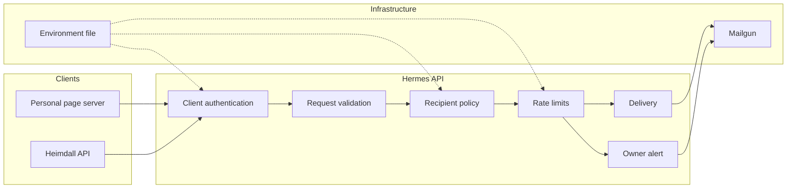
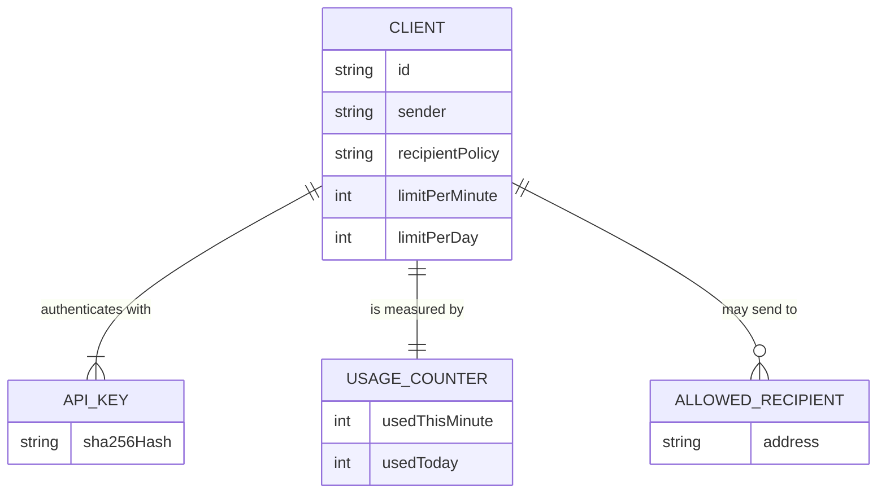
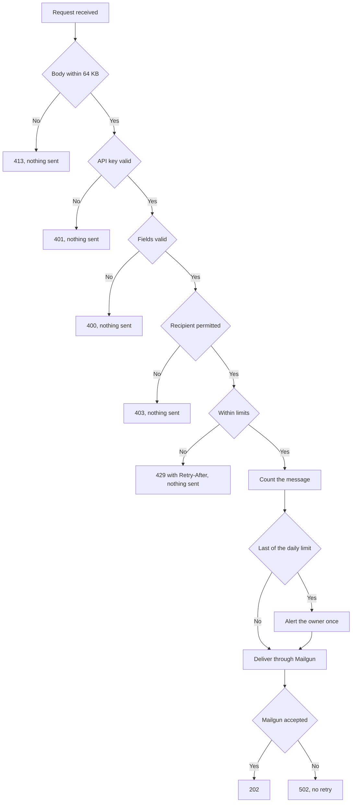

# System Requirements Document — Hermes API

## 1. Introduction

### 1.1 Purpose

This document specifies the functional and non-functional requirements for **Hermes API**.

The concrete technology stack — platform and language versions, libraries, and tooling — is defined
in the [Technology Stack Document](Technology%20Stack%20Document.md). This document states
requirements and refers to that one for specific technologies and versions rather than restating
them.

### 1.2 Scope

The system covers email sending, client authentication, client policy, rate limits, client
configuration and owner alerts. The first version also includes two integrations, whose requirements
are met in the personal page's and Heimdall's own repositories.

In §3.7 and §3.8, "the personal page" and "Heimdall" are the subject of the requirement where the
behavior belongs to them.

### 1.3 Definitions

The terms used here are defined in the [Vision Document](Vision%20Document.md). In addition:

| Term | Definition |
| --- | --- |
| **Active key** | One of the one or two API keys a client is currently configured with. |
| **Pseudonymous reference** | The first twelve hexadecimal characters of the SHA-256 of the trimmed, lower-cased address, as ArturRios.Messaging logs it. |
| **Internal alias** | The name `hermes-api.<environment>` on the edge network. |

---

## 2. System Overview

---

## 3. Functional Requirements

### 3.1 Email Sending

| ID | Requirement |
| --- | --- |
| FR-EM-01 | The system shall accept requests to send an email at `POST /api/emails`. |
| FR-EM-02 | The system shall require a recipient on every request. |
| FR-EM-03 | The system shall require a subject on every request. |
| FR-EM-04 | The system shall require a body on every request. |
| FR-EM-05 | The system shall accept exactly one recipient, as one valid email address, per request. |
| FR-EM-06 | The system shall reject a subject longer than 200 characters. |
| FR-EM-07 | The system shall reject a body longer than 10,000 characters. |
| FR-EM-08 | The system shall accept an optional reply-to on a request. |
| FR-EM-09 | The system shall require a reply-to, when present, to be one valid email address. |
| FR-EM-10 | The system shall answer 400 and send nothing when a request fails validation. |
| FR-EM-11 | The system shall send the body as plain text only. |
| FR-EM-12 | The system shall use a reply-to only as the reply-to of the message. |
| FR-EM-13 | The system shall never send a message to a reply-to address because it was given as one. |
| FR-EM-14 | The system shall deliver each message through Mailgun while handling the request, without a queue. |
| FR-EM-15 | The system shall not retry a failed delivery. |
| FR-EM-16 | The system shall answer 202 when Mailgun accepts a message. |
| FR-EM-17 | The system shall answer 502 when Mailgun refuses a message or cannot be reached. |
| FR-EM-18 | The system shall never store a message body. |
| FR-EM-19 | The system shall never write a message body to its logs. |
| FR-EM-20 | The system shall never write a subject to its logs. |
| FR-EM-21 | The system shall identify a recipient in its logs only by its pseudonymous reference. |
| FR-EM-22 | The system shall, outside production and when Mailgun is not configured, log that a message would have been sent instead of sending it, and answer 202. |

### 3.2 Client Authentication

| ID | Requirement |
| --- | --- |
| FR-AU-01 | The system shall require an API key on every send request, as an `Authorization: Bearer` token. |
| FR-AU-02 | The system shall answer 401 and send nothing when the API key is missing. |
| FR-AU-03 | The system shall answer 401 and send nothing when the API key matches no active key. |
| FR-AU-04 | The system shall identify the calling client solely from its API key. |
| FR-AU-05 | The system shall not accept a client identifier in a request. |
| FR-AU-06 | The system shall compare API key hashes in constant time. |
| FR-AU-07 | The system shall accept either of a client's active keys. |
| FR-AU-08 | The system shall have no public host name and no published port. |

### 3.3 Client Policy

| ID | Requirement |
| --- | --- |
| FR-PO-01 | The system shall send every message from the sender configured for the calling client. |
| FR-PO-02 | The system shall not accept a sender in a request. |
| FR-PO-03 | The system shall check every recipient against the calling client's recipient policy before sending. |
| FR-PO-04 | The system shall answer 403 and send nothing when the policy does not permit the recipient. |
| FR-PO-05 | The system shall support a recipient policy that is a fixed list of addresses. |
| FR-PO-06 | The system shall support a recipient policy that permits any recipient. |

### 3.4 Rate Limits

| ID | Requirement |
| --- | --- |
| FR-RL-01 | The system shall enforce a per-minute limit for each client. |
| FR-RL-02 | The system shall enforce a per-day limit for each client. |
| FR-RL-03 | The system shall keep each client's usage separate from every other client's. |
| FR-RL-04 | The system shall count only messages that pass validation and the recipient policy. |
| FR-RL-05 | The system shall count a message before delivering it, so a failed delivery still counts. |
| FR-RL-06 | The system shall answer 429 when a limit has been reached. |
| FR-RL-07 | The system shall send nothing when a limit has been reached. |
| FR-RL-08 | The system shall include `Retry-After` on a 429, in seconds until the exhausted window ends. |
| FR-RL-09 | The system shall use fixed one-minute windows for the per-minute limit. |
| FR-RL-10 | The system shall use a fixed day that resets at midnight UTC for the per-day limit. |
| FR-RL-11 | The system shall hold usage counters in memory, starting from zero after a restart. |

### 3.5 Client Configuration

| ID | Requirement |
| --- | --- |
| FR-CF-01 | The system shall read its clients from environment configuration at startup. |
| FR-CF-02 | The system shall require every client to define an identifier, a sender, a recipient policy and both limits. |
| FR-CF-03 | The system shall require every client to have one or two active keys. |
| FR-CF-04 | The system shall hold API keys only as SHA-256 hashes. |
| FR-CF-05 | The system shall refuse to start when a client's configuration is invalid. |
| FR-CF-06 | The system shall refuse to start when two clients share an identifier. |
| FR-CF-07 | The system shall refuse to start when one key hash belongs to two clients. |
| FR-CF-08 | The system shall refuse to start, when Mailgun is configured, if a client's sender is not on the Mailgun domain. |
| FR-CF-09 | The system shall refuse to start in production when Mailgun is not configured. |
| FR-CF-10 | The system shall refuse to start in production when no alert address is configured. |
| FR-CF-11 | The system shall have no endpoint that reads or changes its configuration. |
| FR-CF-12 | The system shall apply a configuration change only after a redeploy. |

### 3.6 Owner Alerts

| ID | Requirement |
| --- | --- |
| FR-AL-01 | The system shall email the owner when a client's message uses up the last of its daily limit. |
| FR-AL-02 | The system shall send at most one alert per client per UTC day. |
| FR-AL-03 | The system shall not count an alert against any client's limit. |
| FR-AL-04 | The system shall name the client and its limit in an alert, and include no content from any message. |
| FR-AL-05 | The system shall log a failed alert without changing the answer given to the client. |

### 3.7 Personal Page Integration

| ID | Requirement |
| --- | --- |
| FR-PP-01 | The personal page shall submit its contact form to `POST /api/contact` instead of opening a `mailto:` link. |
| FR-PP-02 | The personal page shall collect the visitor's email address in its contact form. |
| FR-PP-03 | Traefik shall limit `POST /api/contact` to 3 requests per 10 minutes per source, counting an IPv6 source by its /56. |
| FR-PP-04 | The personal page shall reject a request body larger than 64 KB. |
| FR-PP-05 | The personal page shall validate the form with the same field limits as Hermes. |
| FR-PP-06 | The personal page shall answer success without calling Hermes when the honeypot field is filled in. |
| FR-PP-07 | The personal page shall verify the Turnstile token on its server. |
| FR-PP-08 | The personal page shall reject a request that fails Turnstile without calling Hermes. |
| FR-PP-09 | The personal page shall call Hermes at its internal alias. |
| FR-PP-10 | The personal page shall send the visitor's email address as the reply-to. |
| FR-PP-11 | The personal page shall send each message to the owner's address. |
| FR-PP-12 | The personal page shall hold its Hermes key only on its server. |
| FR-PP-13 | The personal page's client shall have a fixed recipient list holding only the owner's address. |
| FR-PP-14 | The personal page's client shall be limited to 5 messages per minute and 50 per day. |
| FR-PP-15 | The personal page shall show the owner's address when Hermes fails, refuses the message or cannot be reached. |
| FR-PP-16 | The personal page shall tell the visitor when the message has been accepted. |
| FR-PP-17 | The personal page shall never send a confirmation to the address the visitor typed. |

### 3.8 Heimdall Integration

| ID | Requirement |
| --- | --- |
| FR-HE-01 | Heimdall shall send all of its email through Hermes, by replacing its `IEmailService` registration. |
| FR-HE-02 | Heimdall shall keep the subject and body of every email unchanged. |
| FR-HE-03 | Heimdall's client shall be configured with the sender Heimdall uses today. |
| FR-HE-04 | Heimdall shall hold no Mailgun credentials. |
| FR-HE-05 | Heimdall shall keep its existing handling of delivery failures. |
| FR-HE-06 | Heimdall shall refuse to start in production without its Hermes settings. |
| FR-HE-07 | Heimdall shall use its logging senders outside production when its Hermes settings are absent. |
| FR-HE-08 | Heimdall shall call Hermes at its internal alias. |
| FR-HE-09 | Heimdall's client shall have a recipient policy that permits any recipient. |
| FR-HE-10 | Heimdall's client shall be limited to 60 messages per minute and 1,000 per day. |

---

## 4. Data Model

Hermes has no database. Clients exist as configuration, usage counters exist in memory, and an email
request exists only while it is handled.

### 4.0 Identifier Strategy

A client is identified by a short name such as `personal-page`, which is unique within an
environment. It is used in configuration, logs and alerts, and is never accepted from a caller. Keys
and email requests have no identifiers.

### 4.1 Entity Relationship Diagram

### 4.2 Client Fields

| Field | Type | Constraints | Description |
| --- | --- | --- | --- |
| Id | string | Required, unique | Short name of the client. |
| KeyHashes | list of string | One or two, each unique across clients | SHA-256 hashes of the active keys. |
| Sender | string | Required, on the Mailgun domain | Address, with an optional display name. |
| RecipientPolicy | string | Required, `fixed` or `any` | Who the client may send to. |
| AllowedRecipients | list of string | At least one when the policy is `fixed` | Permitted addresses. |
| LimitPerMinute | integer | Required, greater than zero | Messages per fixed minute. |
| LimitPerDay | integer | Required, greater than zero | Messages per UTC day. |

### 4.3 Email Request Fields

| Field | Type | Constraints | Description |
| --- | --- | --- | --- |
| To | string | Required, one valid address | The recipient. |
| Subject | string | Required, up to 200 characters | The subject line. |
| Body | string | Required, up to 10,000 characters | Plain text body. |
| ReplyTo | string | Optional, one valid address | Where replies go. |

### 4.4 Usage Counter Fields

| Field | Type | Constraints | Description |
| --- | --- | --- | --- |
| UsedThisMinute | integer | Resets when the minute ends | Counted messages this minute. |
| UsedToday | integer | Resets at midnight UTC | Counted messages this UTC day. |
| AlertedToday | boolean | Resets at midnight UTC | Whether the daily-limit alert went out. |

---

## 5. API Endpoints Overview

### 5.1 Email Endpoints

| Method | Path | Description | Requirement |
| --- | --- | --- | --- |
| POST | `/api/emails` | Send one email. | FR-EM-01 |

### 5.2 Responses

| Status | Meaning | Requirement |
| --- | --- | --- |
| 202 | Mailgun accepted the message. | FR-EM-16 |
| 400 | The request failed validation. | FR-EM-10 |
| 401 | The API key is missing or matches no active key. | FR-AU-02, FR-AU-03 |
| 403 | The recipient policy does not permit the recipient. | FR-PO-04 |
| 413 | The request body is larger than 64 KB. | NFR-02 |
| 429 | A limit has been reached. `Retry-After` is included. | FR-RL-06, FR-RL-08 |
| 502 | Mailgun refused the message or could not be reached. | FR-EM-17 |

Response bodies use the same `DataOutput` format as the owner's other APIs.

---

## 6. Non-Functional Requirements

| ID | Category | Requirement |
| --- | --- | --- |
| NFR-01 | Performance | The system shall give up on a Mailgun call after 10 seconds and treat it as a delivery failure. |
| NFR-02 | Security | The system shall answer 413 to a request body larger than 64 KB. |
| NFR-03 | Security | API keys shall be generated randomly with at least 32 bytes of entropy. |
| NFR-04 | Availability | The system shall run as exactly one container in each environment. |
| NFR-05 | Privacy | The system shall keep no message content after a request has been handled. |

No numeric response-time, throughput or availability targets are set for the first version. This is
a recorded decision: with one endpoint and low traffic, the timeout and the limits are what bound
its behavior.

---

## 7. Authorization Matrix

| Operation | Client | Owner | Anyone else |
| --- | --- | --- | --- |
| Send an email | ⚠️ with its key, within its policy and limits | ❌ | ❌ |
| Add, change or remove a client | ❌ | ✅ through the environment file | ❌ |
| Replace a key | ❌ | ✅ through the environment file | ❌ |
| Read past message content | ❌ | ❌ | ❌ |

Legend: ✅ allowed · ⚠️ allowed under a stated condition · ❌ denied.

---

## 8. Request Handling Strategy

Checks run in this order, each cheaper than or a precondition for the next. Nothing is stored at any
point, and only a request that reaches delivery uses up quota.

Clients have no state beyond existing. A client is added or removed by editing the environment file
and redeploying, and there is no soft delete or history.

---

## 9. Traceability

| Feature | Requirements |
| --- | --- |
| F-01 Email sending | FR-EM-01 through FR-EM-22 |
| F-02 Client authentication | FR-AU-01 through FR-AU-08 |
| F-03 Client policy | FR-PO-01 through FR-PO-06 |
| F-04 Rate limits | FR-RL-01 through FR-RL-11 |
| F-05 Client configuration | FR-CF-01 through FR-CF-12 |
| F-06 Owner alerts | FR-AL-01 through FR-AL-05 |
| F-07 Personal page integration | FR-PP-01 through FR-PP-17 |
| F-08 Heimdall integration | FR-HE-01 through FR-HE-10 |

| Area | Code |
| --- | --- |
| Email Sending | EM |
| Client Authentication | AU |
| Client Policy | PO |
| Rate Limits | RL |
| Client Configuration | CF |
| Owner Alerts | AL |
| Personal Page Integration | PP |
| Heimdall Integration | HE |

| Business Rule | Realized by |
| --- | --- |
| BR-01 | FR-AU-01, FR-AU-02, FR-AU-03 |
| BR-02 | FR-AU-04, FR-AU-05 |
| BR-03 | FR-PO-01, FR-PO-02 |
| BR-04 | FR-PO-03, FR-PO-04 |
| BR-05 | FR-PP-13 |
| BR-06 | FR-HE-09 |
| BR-07 | FR-EM-05 |
| BR-08 | FR-EM-11 |
| BR-09 | FR-EM-08, FR-EM-09, FR-EM-12, FR-EM-13 |
| BR-10 | FR-RL-01, FR-RL-02, FR-RL-03 |
| BR-11 | FR-PP-14 |
| BR-12 | FR-RL-04 |
| BR-13 | FR-RL-06, FR-RL-07, FR-RL-08 |
| BR-14 | FR-EM-14, FR-EM-15 |
| BR-15 | FR-EM-17, FR-PP-15, FR-HE-05 |
| BR-16 | FR-EM-18, FR-EM-19, FR-EM-20 |
| BR-17 | FR-EM-21 |
| BR-18 | FR-CF-04 |
| BR-19 | FR-AL-01 |
| BR-20 | FR-AU-08 |
| BR-21 | FR-CF-09, FR-EM-22 |
| BR-22 | FR-HE-10 |
| BR-23 | FR-AL-02, FR-AL-03 |
| BR-24 | FR-RL-09, FR-RL-10 |
