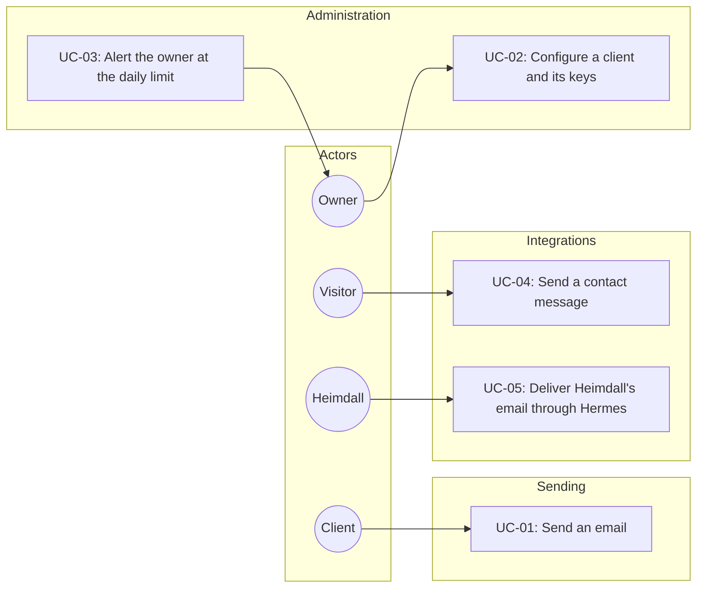
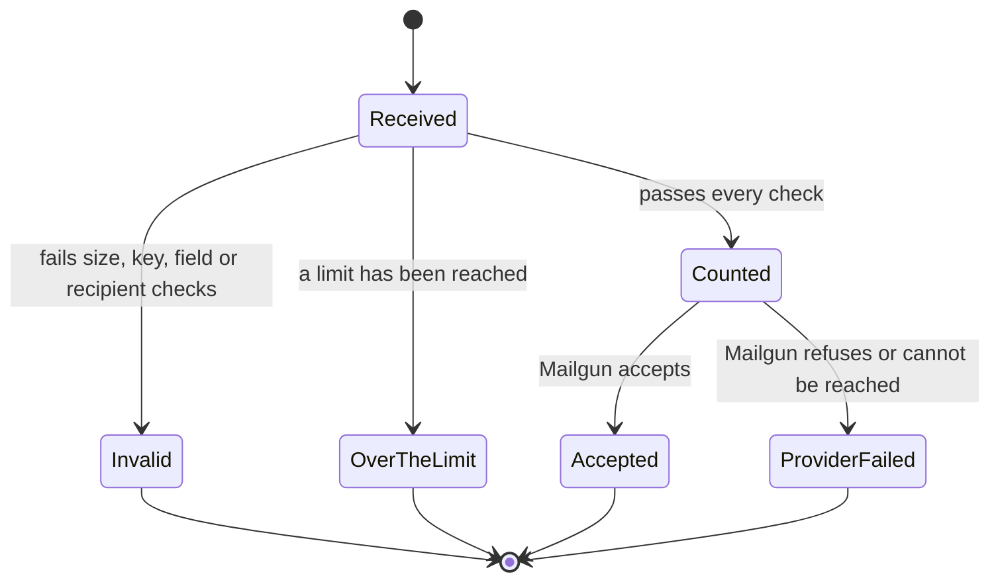
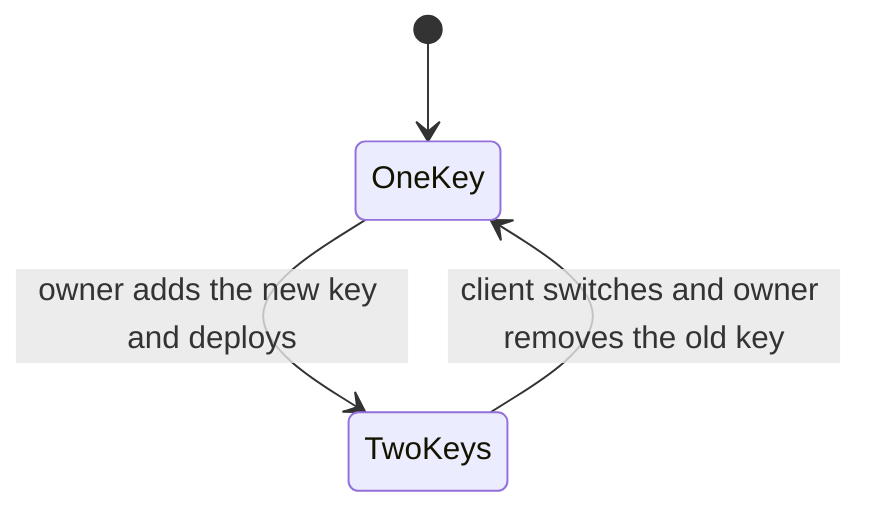

# Use Case Specification Document — Hermes API

## 1. Introduction

### 1.1 Purpose

This document specifies the use cases for **Hermes API**. Each use case describes actor interactions,
preconditions, postconditions, main flows, and alternative/exception flows.

UC-04 and UC-05 are delivered in the personal page's and Heimdall's own repositories. UC-06, the
health check, is specified in the
[Operations & Infrastructure Document](Operations%20%26%20Infrastructure%20Document.md).

### 1.2 Actors

| Actor | Description |
| --- | --- |
| **Client** | A backend holding an API key. In the first version, the personal page's server or Heimdall. |
| **Owner** | Edits the environment file, deploys Hermes, and receives contact messages and alerts. |
| **Visitor** | Someone using the contact form on the personal page. Never reaches Hermes directly. |
| **Mailgun** | External service that delivers the email. |

### 1.3 Use Case Overview

---

## 2. Use Case Specifications

---

### UC-01: Send an email

| Field | Value |
| --- | --- |
| **ID** | UC-01 |
| **Name** | Send an email |
| **Actors** | Client, Mailgun |
| **Description** | Lets a client send one plain text email under its own sender, recipient policy and limits. |
| **Preconditions** | The client is configured and holds an active key. It can reach Hermes on the edge network. |
| **Postconditions** | Mailgun has accepted the message, the client's usage has grown by one, and no message content is kept. |
| **Requirements** | FR-EM-01 through FR-EM-22, FR-AU-01 through FR-AU-08, FR-PO-01 through FR-PO-06, FR-RL-01 through FR-RL-11 |

**Main Flow**

1. The client sends `POST /api/emails` with its key, a recipient, a subject, a body and, optionally, a
   reply-to.
2. The system identifies the client from the key.
3. The system validates the fields.
4. The system checks the recipient against the client's policy.
5. The system checks that the client is within its per-minute and per-day limits, and counts the
   message.
6. The system sends the plain text message through Mailgun, from the client's sender.
7. Mailgun accepts the message.
8. The system answers 202.

**Alternative Flows**

| ID | Condition | Outcome |
| --- | --- | --- |
| AF-01 | The request body is larger than 64 KB. | The system answers 413 and sends nothing. |
| AF-02 | The API key is missing. | The system answers 401 and sends nothing. |
| AF-03 | The API key matches no active key. | The system answers 401 and sends nothing. |
| AF-04 | The client uses its second active key. | The flow continues as normal. |
| AF-05 | A field is missing or invalid. | The system answers 400, sends nothing and counts nothing. |
| AF-06 | The policy does not permit the recipient. | The system answers 403, sends nothing and counts nothing. |
| AF-07 | The per-minute limit has been reached. | The system answers 429 with `Retry-After` until the minute ends, and sends nothing. |
| AF-08 | The per-day limit has been reached. | The system answers 429 with `Retry-After` until midnight UTC, and sends nothing. |
| AF-09 | Mailgun refuses the message. | The system answers 502, does not retry, and the message stays counted. |
| AF-10 | Mailgun cannot be reached, or does not answer within 10 seconds. | The system answers 502, does not retry, and the message stays counted. |
| AF-11 | Mailgun is not configured, outside production. | The system logs that a message would have been sent, without its subject or body, and answers 202. |

---

### UC-02: Configure a client and its keys

| Field | Value |
| --- | --- |
| **ID** | UC-02 |
| **Name** | Configure a client and its keys |
| **Actors** | Owner |
| **Description** | Lets the owner add, change or remove a client, or replace its key, without an admin API. |
| **Preconditions** | The owner can edit the environment's `hermes-api.env` and deploy Hermes. |
| **Postconditions** | Hermes runs with the new configuration, and removed keys no longer work. |
| **Requirements** | FR-CF-01 through FR-CF-12 |

**Main Flow**

1. The owner generates a random key and its SHA-256 hash, when the change needs a key.
2. The owner edits the client's entry in the environment file.
3. The owner deploys Hermes.
4. The system reads its clients at startup and checks the configuration.
5. The system starts and applies the new configuration.

**Alternative Flows**

| ID | Condition | Outcome |
| --- | --- | --- |
| AF-01 | A client is missing a required setting or has an invalid one. | The system refuses to start and names the client and the setting. |
| AF-02 | A client has no key, or more than two. | The system refuses to start. |
| AF-03 | Two clients share an identifier. | The system refuses to start. |
| AF-04 | One key hash belongs to two clients. | The system refuses to start. |
| AF-05 | Mailgun is configured and a client's sender is not on its domain. | The system refuses to start. |
| AF-06 | The environment is production and Mailgun is not configured. | The system refuses to start. |
| AF-07 | The environment is production and no alert address is configured. | The system refuses to start. |
| AF-08 | The owner replaces a key. | The owner adds the new key as the second key and deploys, switches the client to it, then removes the old key and deploys again. |

---

### UC-03: Alert the owner at the daily limit

| Field | Value |
| --- | --- |
| **ID** | UC-03 |
| **Name** | Alert the owner at the daily limit |
| **Actors** | Owner, Mailgun |
| **Description** | Tells the owner by email that a client has used up its daily limit, which means likely abuse or a limit set too low. |
| **Preconditions** | An alert address is configured. A client's message has passed every check in UC-01. |
| **Postconditions** | The owner has been sent one alert for that client for that UTC day. |
| **Requirements** | FR-AL-01 through FR-AL-05 |

**Main Flow**

1. A client's message uses up the last of its daily limit.
2. The system sends the owner an alert naming the client and its limit, with no content from any
   message.
3. The system records that the client has been alerted for this UTC day.
4. The client's own message continues through UC-01.

**Alternative Flows**

| ID | Condition | Outcome |
| --- | --- | --- |
| AF-01 | The client has already been alerted this UTC day. | No alert is sent. |
| AF-02 | The alert cannot be delivered. | The system logs the failure, and the answer to the client does not change. |
| AF-03 | No alert address is configured, outside production. | The system logs that an alert would have been sent. |

---

### UC-04: Send a contact message

| Field | Value |
| --- | --- |
| **ID** | UC-04 |
| **Name** | Send a contact message |
| **Actors** | Visitor, Client (personal page), Mailgun |
| **Description** | Lets a visitor send the owner a message directly from the site, through a protected public route. |
| **Preconditions** | The personal page's client is configured with its fixed recipient list and limits. |
| **Postconditions** | The owner has the message and can reply to the visitor's address. Nothing has been sent to the visitor. |
| **Requirements** | FR-PP-01 through FR-PP-17 |

**Main Flow**

1. The visitor fills in their email address, a subject and a message, and submits the form.
2. Traefik checks the per-source limit and passes the request on.
3. The site checks the body size and validates the fields.
4. The site verifies the Turnstile token on its server.
5. The site calls Hermes at its internal alias with its key, the owner's address as recipient and the
   visitor's address as reply-to.
6. Hermes accepts the message, as in UC-01.
7. The site tells the visitor that the message has been accepted.

**Alternative Flows**

| ID | Condition | Outcome |
| --- | --- | --- |
| AF-01 | The source is over 3 requests per 10 minutes. | Traefik answers 429, and the request never reaches the site. |
| AF-02 | The body is larger than 64 KB. | The site rejects the request without calling Hermes. |
| AF-03 | A field is missing or invalid. | The site shows the error without calling Hermes. |
| AF-04 | The honeypot field is filled in. | The site answers success without calling Hermes. |
| AF-05 | Turnstile verification fails. | The site rejects the request without calling Hermes. |
| AF-06 | Hermes answers that a limit has been reached. | The site shows the owner's address instead. |
| AF-07 | Hermes answers that delivery failed. | The site shows the owner's address instead. |
| AF-08 | Hermes cannot be reached. | The site shows the owner's address instead. |

---

### UC-05: Deliver Heimdall's email through Hermes

| Field | Value |
| --- | --- |
| **ID** | UC-05 |
| **Name** | Deliver Heimdall's email through Hermes |
| **Actors** | Client (Heimdall), Mailgun |
| **Description** | Moves all of Heimdall's email onto Hermes, with the same content and failure handling as before. |
| **Preconditions** | Heimdall's client is configured with its current sender, the any-recipient policy and its limits. |
| **Postconditions** | Heimdall's user has the email with its usual content, and Heimdall holds no Mailgun credentials. |
| **Requirements** | FR-HE-01 through FR-HE-10 |

**Main Flow**

1. Heimdall has an email to send, through one of its existing senders.
2. Heimdall's `IEmailService` registration, now backed by Hermes, calls Hermes at its internal alias
   with its key.
3. Hermes accepts the message, as in UC-01.
4. Heimdall carries on as it does today after a successful send.

**Alternative Flows**

| ID | Condition | Outcome |
| --- | --- | --- |
| AF-01 | Hermes refuses the message or delivery fails. | Heimdall logs the failure and does not propagate it, as it does today. |
| AF-02 | Hermes cannot be reached. | Heimdall logs the failure and does not propagate it, as it does today. |
| AF-03 | The email is the restriction lift notification. | Heimdall reports whether it was accepted, as it does today. |
| AF-04 | The Hermes settings are absent, outside production. | Heimdall uses its logging senders. |
| AF-05 | The Hermes settings are absent, in production. | Heimdall refuses to start. |

---

## 3. Use Case — Requirements Traceability

| Use Case | Requirements |
| --- | --- |
| UC-01: Send an email | FR-EM-01 through FR-EM-22, FR-AU-01 through FR-AU-08, FR-PO-01 through FR-PO-06, FR-RL-01 through FR-RL-11 |
| UC-02: Configure a client and its keys | FR-CF-01 through FR-CF-12 |
| UC-03: Alert the owner at the daily limit | FR-AL-01 through FR-AL-05 |
| UC-04: Send a contact message | FR-PP-01 through FR-PP-17 |
| UC-05: Deliver Heimdall's email through Hermes | FR-HE-01 through FR-HE-10 |

---

## 4. State Diagrams

### 4.1 Email Request Lifecycle

### 4.2 API Key Replacement

