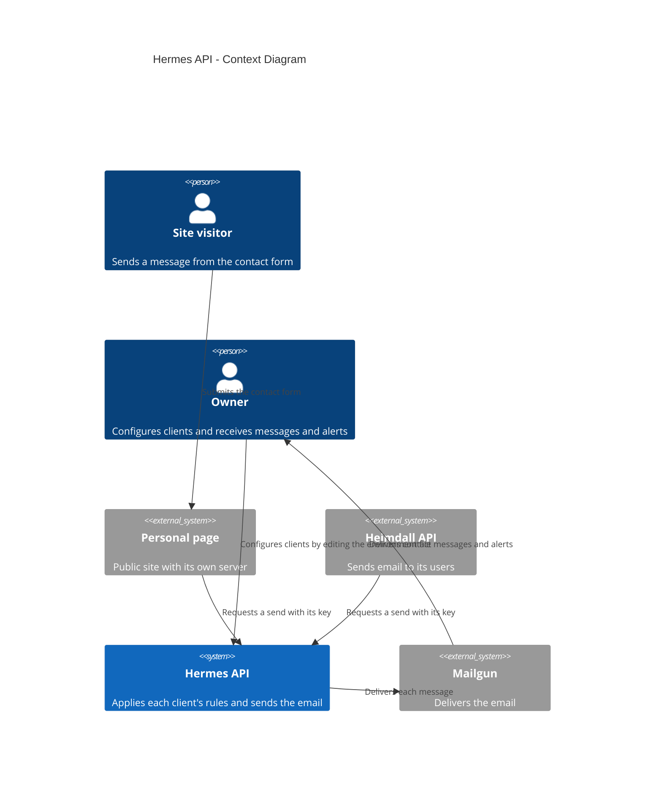
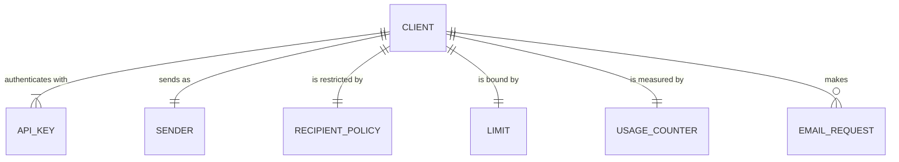
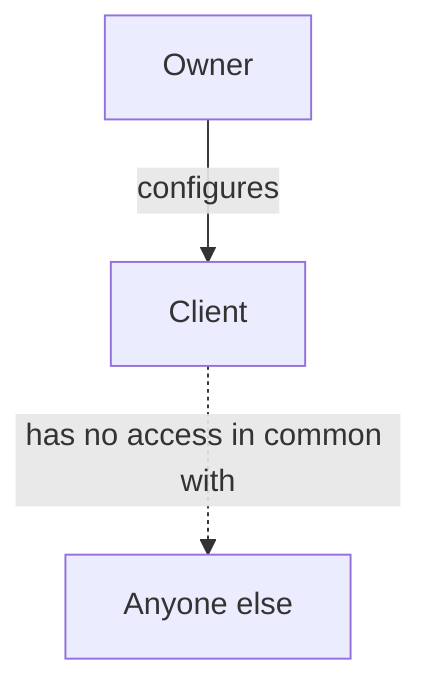

# Vision Document — Hermes API

## 1. Introduction

### 1.1 Purpose

This document establishes why Hermes API exists and what it does. Hermes is an internal HTTP service
that sends plain text email on behalf of the owner's other backends, under rules set per calling
project.

### 1.2 Scope

The first version covers the Hermes service itself and two integrations: the contact form on the
personal page, and the delivery of all of Heimdall's email.

Out of scope:

- A public endpoint, or anything that places a key in a browser.
- Newsletters, bulk sending and mailing lists.
- HTML templates, attachments and open tracking.
- Receiving email.
- Storing message bodies.
- A user interface or an admin API.
- Queues and automatic retries.
- Forms for sites without a server of their own.

### 1.3 Definitions and Acronyms

| Term | Definition |
| --- | --- |
| **Client** | A project allowed to call Hermes, such as the personal page or Heimdall. |
| **API key** | The secret a client authenticates with. Hermes keeps only its hash. |
| **Sender** | The address, with an optional display name, that a client's email goes out from. |
| **Recipient policy** | Who a client may send to: a fixed list of addresses, or anyone. |
| **Limit** | How many messages a client may send in one minute and in one day. |
| **Usage counter** | How much of its limits a client has used in the current windows. |
| **Email request** | One message to send: recipient, subject, body and optional reply-to. |
| **Owner** | The person who runs Hermes and its clients, and who receives contact messages and alerts. |
| **Visitor** | Someone using the contact form on the personal page. |
| **Edge network** | The Docker network that the owner's services share on a host. |

---

## 2. Problem Statement

The contact form on the personal page only opens the visitor's own mail client, so a visitor cannot
send a message from the site itself.

Heimdall can send email, but its Mailgun credentials and sending are tied to Heimdall. Every new
project that needs email would repeat the credentials, the sender code and the limits.

An email route is also a target. Each accepted request becomes an email, so abuse can flood an inbox,
use up the Mailgun quota, damage the domain's sending reputation, or send spam to strangers. Even if
every other defense fails, the damage has to stay small and fixed.

---

## 3. Product Position Statement

| Attribute | Description |
| --- | --- |
| **For** | The owner's backend services |
| **Who** | Need to send email without each holding Mailgun credentials and its own limits |
| **The Hermes API** | Is an internal email delivery service |
| **That** | Sends each message under rules set per client, so the harm from abuse stays small and fixed |
| **Unlike** | A `mailto:` link that depends on the visitor's mail client, or Mailgun credentials built into each project |
| **Our product** | Has no public route, and gives each client its own recipients and limits |

---

## 4. Stakeholders

| Stakeholder | Role | Concern |
| --- | --- | --- |
| Owner | Operates Hermes and its clients | Abuse stays contained, messages arrive, and no message content is kept. |
| Site visitors | Send messages through the personal page | The form works, and a failure is clearly reported. |
| Heimdall users | Receive verification, password reset and notice emails | The emails keep arriving, with the same content. |
| Future backends | Join as new clients | Adding one needs only configuration. |

---

## 5. High-Level Architecture

---

## 6. Core Features

| ID | Feature | Description |
| --- | --- | --- |
| F-01 | Email sending | Validates and sends one plain text message per request, and keeps none of its content. |
| F-02 | Client authentication | Identifies each calling project by its own API key, on internal networks only. |
| F-03 | Client policy | Applies each client's sender and recipient policy on the server. |
| F-04 | Rate limits | Enforces separate per-minute and per-day limits for each client. |
| F-05 | Client configuration | Defines clients, keys and rules in the environment, and checks them at startup. |
| F-06 | Owner alerts | Emails the owner when a client reaches its daily limit. |
| F-07 | Personal page integration | Lets visitors send a message directly from the site through a protected public route. |
| F-08 | Heimdall integration | Moves all of Heimdall's email onto Hermes without changing its content or failure handling. |

---

## 7. Domain Model Overview

An email request is never stored. It exists only while Hermes handles it, and appears here because
every rule applies to it. Everything else is configuration, except the usage counters, which are
held in memory.

---

## 8. Roles Hierarchy

| Role | Relationship | Permissions |
| --- | --- | --- |
| **Owner** | Controls the environment Hermes runs in | Adds and removes clients, sets their rules and replaces keys. |
| **Client** | Holds an API key | Sends email within its own sender, recipient policy and limits. |
| **Anyone else** | Has no key and no route to the service | Nothing. |

---

## 9. Constraints

- The platform is the one defined in the [Technology Stack Document](Technology%20Stack%20Document.md).
- Mailgun is the delivery provider, on the sending domain Heimdall already uses.
- Hermes is deployed by yggdrasil, on the owner's own servers.
- Hermes has no public route.
- No message body is ever stored, and no subject or body is ever logged.
- Rate limit counters are held in memory, so each environment runs exactly one container.
- There are no compliance requirements beyond these storage and logging rules. Heimdall's disclosure
  naming Mailgun stays correct, because Mailgun still delivers its email.

---

## 10. Success Criteria

- A message sent from the personal page reaches the owner's inbox, and the owner can reply to it.
- The personal page's key cannot send email to anyone but the owner.
- Heimdall's emails reach its users through Hermes with the same content as before.
- Heimdall no longer holds Mailgun credentials.
- A client over its limit gets a 429, and no email goes out.
- One client reaching its limit does not affect another client.
- Logs never contain a subject or a body.
